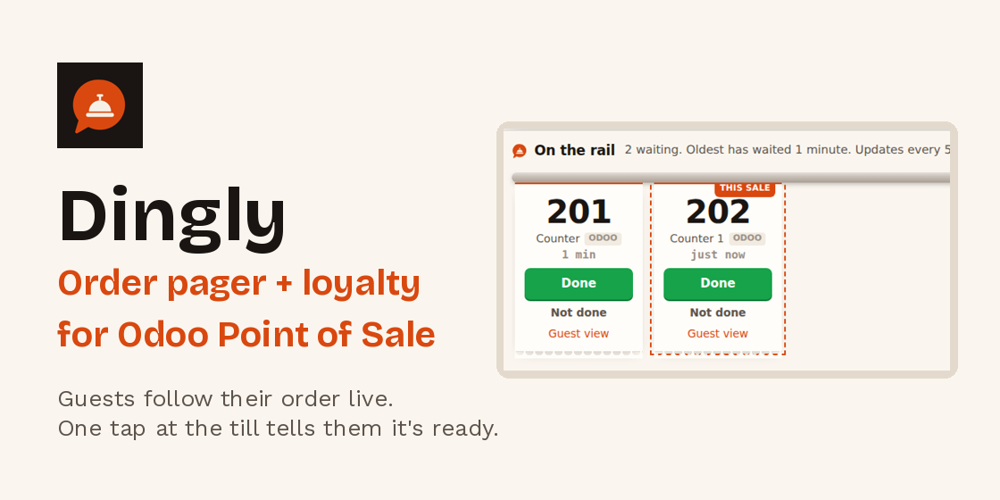

# Dingly for Odoo Point of Sale

Order pager, live "On the rail" board and stamp card for **Odoo 19** POS. Guests follow their order on their own phone; one tap at the till tells them it's ready. The full Dingly shop app also opens inside Odoo, behind your Dingly login.

## Install

- **Odoo Apps Store:** search for "Dingly" and install.
- **Manually:** download `pager_pos` from this repository (or https://dingly.win/pager_pos.zip), put it in your Odoo addons path, restart Odoo, Apps → Update Apps List → install **Dingly**.

## Connect a register

1. Create your shop at https://dingly.win and add a site.
2. In Dingly: **Sites → Odoo → Issue setup token**.
3. In Odoo: **Point of Sale → Configuration → Dingly Setup**, pick the register, keep the API base `https://dingly.win`, paste the token.

Details: [pager_pos/README.md](pager_pos/README.md). Support: https://dingly.win/support

License: LGPL-3 (see LICENSE). Branch `19.0` targets Odoo 19.
